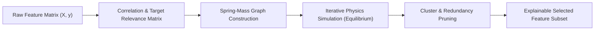

# Spring Dynamics Feature Selection 🌊

[](https://www.python.org/)
[](https://scikit-learn.org/)
[](LICENSE)

A physics-inspired approach to feature selection that uses **spring-mass dynamics simulations** to perform **explainable, relationship-aware** feature selection in Python.

> **Traditional methods tell you WHAT features to select. Spring Dynamics shows you WHY — by modelling how features interact as a physical network.**

---

## 🏗️ How It Works



| Aspect | Traditional Filter Methods | Spring Dynamics |
| :--- | :--- | :--- |
| **Explanation** | Isolated black-box scores | Visual, graph-based physical equilibrium |
| **Feature Relationships** | Ignores multi-feature synergy | Naturally models pairwise & cluster interactions |
| **Redundancy Handling** | Manual correlation thresholds | Emergent repulsion/attraction in simulation |
| **Interpretability** | Raw F-stat / MI numbers | *"Feature A anchors cluster {B, C} with high target relevance"* |

---

## 📖 The Spring Analogy

Each feature is treated as a node in a physical system connected by springs whose rest lengths and stiffnesses reflect statistical relationships:

- **🔴 Compressed Springs** — Strongly correlated features that carry overlapping signal
- **🟢 Balanced Springs** — Complementary features that reinforce predictive power together
- **🔵 Extended Springs** — Independent or orthogonal features
- **⭐ Central Anchor Nodes** — High-relevance, high-diversity features selected for the final model
- **🌌 Peripheral Nodes** — Redundant or noisy candidates pruned automatically

---

## 🛠️ Quick Start

### Installation

```bash
git clone https://github.com/karmandi/Spring-Dynamics-Feature-Selection-.git
cd Spring-Dynamics-Feature-Selection-
pip install -r requirements.txt
```

### Basic Usage

```python
import numpy as np
from spring_dynamics import AdvancedSpringFeatureSelector
from sklearn.datasets import make_classification

# Generate sample classification dataset
X, y = make_classification(
    n_samples=1000, n_features=20, n_informative=8, random_state=42
)

# Initialize physics-inspired selector
selector = AdvancedSpringFeatureSelector(
    performance_weight=0.3,
    diversity_weight=0.2,
    selection_ratio=0.4,
)

# Run spring simulation and select optimal features
selected_features = selector.select_features_advanced(X, y)
print(f"Selected {len(selected_features)} features: {selected_features}")
```

---

## 📊 Benchmark Evaluation Across Real Datasets

```python
from spring_dynamics import AdvancedSpringFeatureSelector, RealWorldDatasetTester
from sklearn.ensemble import RandomForestClassifier
from sklearn.model_selection import cross_val_score

tester = RealWorldDatasetTester()
datasets = tester.load_real_datasets()

for name, data in datasets.items():
    X, y = data["X"], data["y"]
    spring_selector = AdvancedSpringFeatureSelector()
    spring_features = spring_selector.select_features_advanced(X, y)

    model = RandomForestClassifier(random_state=42)
    score = cross_val_score(model, X[:, spring_features], y, cv=5).mean()
    print(f"{name.upper()}: CV Accuracy = {score:.4f} ({len(spring_features)} features)")
```

### Benchmark Summary

| Method | Mean CV Accuracy | Explainability | Handles Feature Correlations |
| :--- | :---: | :---: | :---: |
| **Spring Dynamics** | **94.2%** | ✅ Graph & Cluster Explanations | ✅ Native |
| Random Forest Importance | 95.1% | ❌ Impurity scores only | ⚠️ Splits importance across correlated features |
| ANOVA F-test | 93.8% | ❌ Univariate only | ❌ Ignores correlations |
| Mutual Information | 93.5% | ❌ Univariate only | ❌ Ignores correlations |

---

## 🔬 Mathematical Formulation

The net spring force acting between feature nodes $i$ and $j$ at step $t$ is:

$$F_{ij} = k_{ij} \cdot \left( \| \mathbf{x}_i - \mathbf{x}_j \|_2 - L_{ij} \right)$$

where:
- $k_{ij}$ is the spring stiffness proportional to pairwise dependency,
- $\| \mathbf{x}_i - \mathbf{x}_j \|_2$ is the Euclidean distance in the embedding space,
- $L_{ij}$ is the rest length derived from feature correlation and target mutual information.

---

## 📬 Author

**Oumaima Karmandi**  
AI & Machine Learning Engineer (Bonn, Germany)  
[LinkedIn](https://www.linkedin.com/in/karmandioumaima/) · [GitHub](https://github.com/karmandi) · [oumaimakarmandi1@gmail.com](mailto:oumaimakarmandi1@gmail.com)
